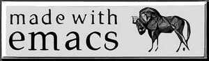

# 石下读书

- [治病的成本](action/medicine/2023_11_28_cost_of_treatment.md)

- [溺水急救](action/medicine/drown.md)

- [和若溪小朋友聊写字](action/handwriting/2023_07_15_children_write/index.md)

- [和小朋友聊写字——从楷书到行书](action/handwriting/2024_04_27_regular_script_semi_cursive_script/index.md)

- [种田忆旧](action/memory/2022_fram.md)

- [自制的陀螺](action/memory/gyro.md)

- [我们的十年](action/memory/junior_high_school_ten_years.md)

- [浮光掠影过苏州](action/memory/travels/2022_09_Shanghai_Tourist/index.md)

- [竹排摇梦过桂林](action/memory/travels/2023_04_GuiLin_tourist/index.md)

- [走过甘肃](action/memory/travels/Gansu_Province_and_2019/index.md)
 
- [你真的需要提高技术吗？](action/memory/badminton_technique.md)

- [下厨房](action/memory/cooking.md)

- [答辩PPT写法总结](action/systems_in_practice/2023_01_17_ppt.md)

- [一次就好](action/systems_in_practice/single_step.md)

- [有志与有悔](./essay/book/2022_05_03_Wang_An_Shi.md)

- [陈省身先生](knowledge/reflection/2019_12_29_maths_Chern.md)

- [读《启功给你讲书法》](knowledge/reflection/2019_12_01_calligraphy_qigong.md)

- [莫放春秋佳日去](knowledge/reflection/teacher.md)

- [看《红鳉鱼》](knowledge/reflection/the_red_Killifish.md)

- [浅析基本数据结构](action/systems_in_practice/algorithm/2023_7_28_basic_data_structures/index.md)

- [浅析基本排序算法](action/systems_in_practice/algorithm/2023_08_16_sort/index.md)

